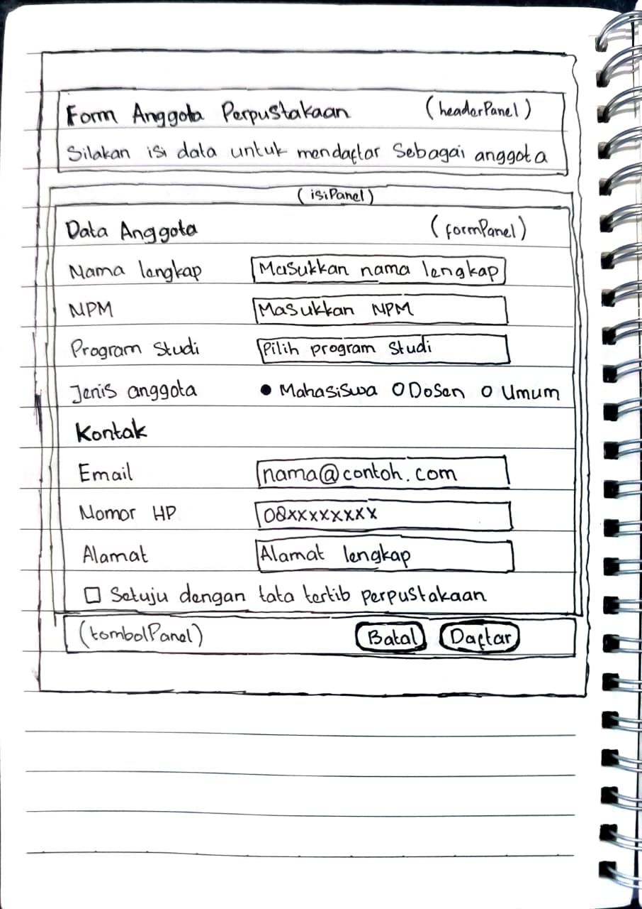

# Praktikum PBO 2 Pertemuan 4

## Layout Manager dan Desain Form

**Mata Kuliah:** Pemrograman Berbasis Objek 2 (PBO 2)  

## 1. Sketsa Form Anggota Perpustakaan

Sketsa form dibuat sebagai rancangan awal sebelum implementasi menggunakan JFrame Form di NetBeans.

*Gambar 1. Sketsa rancangan Form Anggota Perpustakaan.*

## 2. Tabel Rancangan Form Anggota Perpustakaan

| Bagian | Panel/Komponen | Layout | Keterangan |
|---|---|---|---|
| Jendela | JFrame | BorderLayout | Wadah utama form |
| Header | `headerPanel` | BoxLayout (Y Axis) | Menampilkan judul dan keterangan |
| Isi form | `isiPanel` | BorderLayout | Membungkus area isian form |
| Form dan isian | `formPanel` | GridBagLayout | Menyusun label dan isian dalam baris dan kolom |
| Data Anggota | JLabel dan JTextField | GridBagLayout | Isian NPM dan nama lengkap |
| Program Studi | JComboBox | GridBagLayout | Memilih program studi |
| Jenis Anggota | JRadioButton dan ButtonGroup | GridBagLayout dengan panel pilihan | Memilih Mahasiswa, Dosen, atau Umum |
| Kontak | JTextField | GridBagLayout | Isian email dan nomor HP |
| Alamat | JTextArea dalam JScrollPane | GridBagLayout | Mengisi alamat dalam beberapa baris |
| Persetujuan | JCheckBox | GridBagLayout | Persetujuan tata tertib perpustakaan |
| Tombol | `tombolPanel` | FlowLayout (Right) | Menempatkan tombol Batal dan Daftar di kanan bawah |