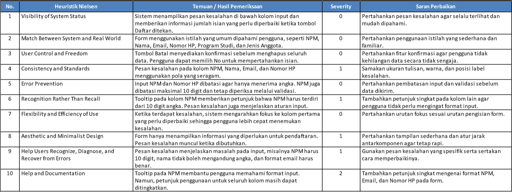
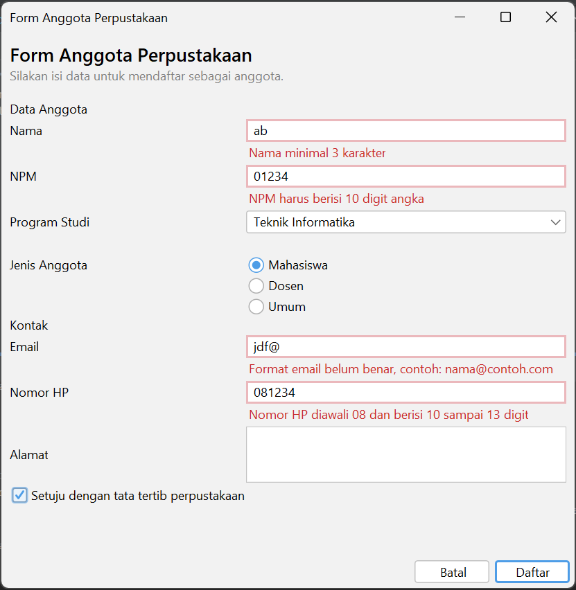
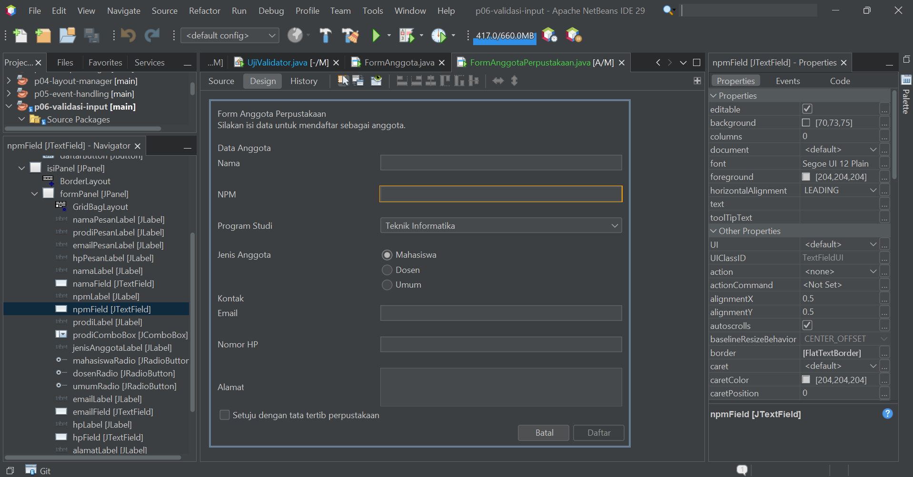

# P06 – Validasi Input dan Kegunaan

## Deskripsi Proyek

Proyek ini merupakan pengembangan form pendaftaran anggota perpustakaan dari praktikum sebelumnya. Pada praktikum ini ditambahkan fitur validasi input untuk memastikan data yang dimasukkan pengguna sesuai dengan aturan yang telah ditentukan.

Form utama yang digunakan adalah `FormAnggotaPerpustakaan`. Validasi dilakukan pada NPM, nama, email, dan nomor HP. Selain itu, terdapat pesan kesalahan, pembatasan karakter, konfirmasi penghapusan data, serta penerapan aksesibilitas pada komponen form.

## Fitur yang Diterapkan

1. NPM harus terdiri dari 10 digit angka.
2. Nama wajib diisi, minimal 3 karakter, dan tidak boleh mengandung angka.
3. Email harus menggunakan format yang benar.
4. Nomor HP harus diawali dengan angka 08 dan memiliki panjang sesuai ketentuan.
5. NPM dan nomor HP hanya menerima input berupa angka.
6. Input yang tidak valid ditandai dengan garis merah dan pesan kesalahan.
7. Tombol Daftar menampilkan jumlah kesalahan dan mengarahkan fokus ke kolom pertama yang salah.
8. Tombol Batal menampilkan konfirmasi sebelum menghapus data.
9. Penerapan tooltip, mnemonic, dan labelFor untuk membantu penggunaan form.

## Screenshot

### 1. Peer Review

Screenshot hasil penilaian form berdasarkan 10 heuristik Nielsen yang dilakukan bersama teman.

### 2. Tampilan Input Salah

Screenshot form ketika pengguna memasukkan data yang tidak sesuai dengan aturan validasi. Sistem akan menampilkan garis merah dan pesan kesalahan pada kolom terkait.

### 3. Navigator

Screenshot jendela Navigator NetBeans yang memperlihatkan susunan komponen pada form, termasuk label pesan kesalahan.

## Jawaban Eksperimen Praktikum 4

### 1. Apa yang terjadi ketika huruf diketik pada isian NPM? Baris mana yang menyebabkannya?

Huruf tidak akan masuk ke dalam kolom NPM karena kolom tersebut hanya menerima angka. Hal ini dilakukan dengan pemeriksaan `Character.isDigit(evt.getKeyChar())`. Jika karakter bukan angka, `evt.consume()` akan membatalkan input tersebut.

### 2. Isi email dengan `siti@`, lalu tekan Tab. Kapan pesan kesalahan muncul?

Pesan kesalahan muncul ketika kursor meninggalkan kolom email atau saat event `focusLost` dijalankan. Sistem kemudian memeriksa format email dan menampilkan pesan kesalahan karena `siti@` belum memiliki domain yang benar.

### 3. Klik isian Nama tanpa mengetik, lalu tekan Tab. Mengapa tidak ada pesan kesalahan?

Karena validasi ketika kolom kehilangan fokus hanya dilakukan jika kolom sudah berisi teks. Hal ini bertujuan agar pengguna tidak langsung mendapatkan peringatan ketika baru berpindah antar kolom. Namun, ketika tombol Daftar ditekan, seluruh kolom tetap diperiksa sehingga nama yang kosong akan ditandai sebagai kesalahan.

### 4. Centang persetujuan, lalu klik Daftar dengan form kosong. Isian mana yang mendapat fokus?

Fokus akan diarahkan ke kolom NPM karena merupakan kolom pertama yang diperiksa dan belum memenuhi aturan validasi. Hal ini membantu pengguna mengetahui bagian pertama yang harus diperbaiki.

### 5. Tekan tombol Alt bersama huruf N. Isian mana yang mendapat fokus, dan properti apa yang mengaturnya?

Fokus akan berpindah ke kolom NPM. Hal ini diatur menggunakan properti `displayedMnemonic` pada label NPM dengan huruf N dan properti `labelFor` untuk menghubungkan label dengan kolom NPM.

### 6. Isi beberapa isian, lalu klik Batal dan pilih No. Apakah data tetap ada?

Ya, data tetap ada karena pilihan No membatalkan proses pengosongan form. Data hanya akan dihapus apabila pengguna memilih Yes pada jendela konfirmasi.

## Pengujian

Pengujian validasi dilakukan menggunakan kelas `UjiValidator`. Pengujian mencakup input kosong, input dengan format yang salah, dan input yang sesuai dengan ketentuan.

Selain itu, form diuji secara langsung untuk memastikan pembatasan karakter, tampilan pesan kesalahan, perpindahan fokus, serta konfirmasi tombol Batal berjalan dengan baik.

## Deklarasi Penggunaan AI

Dalam pengerjaan praktikum ini, saya menggunakan ChatGPT sebagai alat bantu untuk memahami kode dan merapikan kalimat termasuk penulisan format file README.md
