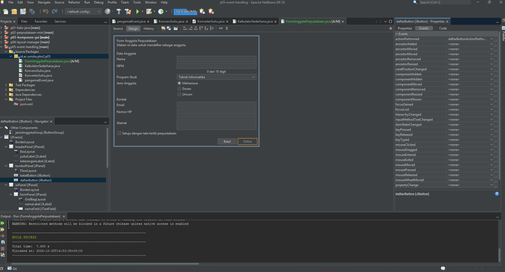
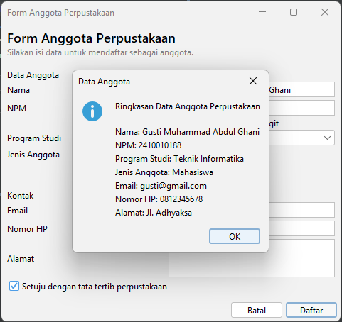
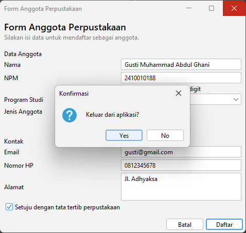

# P05 - Event Handling

## Identitas Praktikum

- Mata Kuliah: Pemrograman Berbasis Objek 2 (PBO 2)
- Pertemuan: 5
- Materi: Event Handling

## 1. Peta Event FormAnggotaPerpustakaan

| No. | Komponen                         | Menu Events | Event              | Aksi                                                                                    |
| --- | -------------------------------- | ----------- | ------------------ | --------------------------------------------------------------------------------------- |
| 1   | `setujuCheckBox`                 | Item        | `itemStateChanged` | Tombol Daftar aktif jika kotak persetujuan dicentang dan nonaktif jika centang dihapus. |
| 2   | `batalButton`                    | Action      | `actionPerformed`  | Mengosongkan semua isian dan mengembalikan fokus ke NPM.                                |
| 3   | `daftarButton`                   | Action      | `actionPerformed`  | Menampilkan ringkasan data anggota menggunakan `JOptionPane`.                           |
| 4   | `npmField`                       | Key         | `keyReleased`      | Menampilkan jumlah digit NPM, misalnya 8 dari 10 digit.                                 |
| 5   | JFrame `FormAnggotaPerpustakaan` | Window      | `windowClosing`    | Meminta konfirmasi sebelum aplikasi ditutup.                                            |

### Pengaturan Form

- `defaultCloseOperation` diatur menjadi `DO_NOTHING`.
- Tombol Daftar tidak aktif pada kondisi awal.
- Event dibuat melalui menu Events pada NetBeans GUI Builder.
- File `.java` dan `.form` disimpan bersama dalam repository.

## 2. Tabel Pengamatan Praktikum 2

| No. | Tindakan                                   | Event yang Tercatat                                                                                |
| --- | ------------------------------------------ | -------------------------------------------------------------------------------------------------- |
| 1   | Arahkan kursor ke tombol, lalu jauhkan.    | `MouseEvent`: `mouseEntered`, kemudian `mouseExited`.                                              |
| 2   | Klik tombol Klik saya.                     | `ActionEvent`: `actionPerformed`.                                                                  |
| 3   | Centang lalu hapus centang Aktifkan fitur. | `ItemEvent`: `itemStateChanged` saat dicentang dan saat centang dihapus.                           |
| 4   | Ganti pilihan dari Pagi menjadi Malam.     | `ItemEvent`: pilihan Pagi mengalami `DESELECTED`, lalu Malam mengalami `SELECTED`.                 |
| 5   | Klik isian, lalu ketik `abc`.              | `FocusEvent`: `focusGained`; `KeyEvent`: `keyTyped` untuk karakter yang diketik.                   |
| 6   | Klik tombol setelah mengetik di isian.     | `FocusEvent`: `focusLost` pada isian dan `ActionEvent`: `actionPerformed` pada tombol yang diklik. |

## Dokumentasi Screenshot

### Properties Events Tombol Daftar

### Dialog Ringkasan Data Anggota

### Dialog Konfirmasi Keluar

## 3. Jawaban Eksperimen Praktikum 3 - Konversi Suhu

### Eksperimen 1

Jika pemeriksaan `evt.getStateChange() == ItemEvent.SELECTED` dihapus, pesan `item berubah` biasanya tercetak dua kali saat pilihan Combo Box diganti. Hal ini terjadi karena pilihan lama mengalami `DESELECTED` dan pilihan baru mengalami `SELECTED`.

### Eksperimen 2

Jika `keyReleased` diganti menjadi `keyPressed`, hasil terlambat satu karakter karena event `keyPressed` berjalan sebelum karakter baru selesai dimasukkan ke dalam isian.

### Eksperimen 3

Jika blok `try-catch` dihapus lalu huruf dimasukkan, `Double.parseDouble()` menghasilkan `NumberFormatException`. Exception muncul di jendela Output atau console dan proses konversi gagal.

## 4. Jawaban Eksperimen Praktikum 4 - Kalkulator Sederhana

### Eksperimen 1

Jika event `actionPerformed` dibuat untuk tombol kali tanpa menghapus lambda di konstruktor, pesan `kali` tercetak dua kali. Penyebabnya adalah dua mekanisme event menjalankan aksi yang sama. Satu tombol sebaiknya hanya menggunakan satu mekanisme event agar tidak terjadi aksi ganda.

### Eksperimen 2

Untuk menambahkan tombol modulus (`%`), tombol ditambahkan pada `operatorPanel` melalui tab Design dan diberi nama variabel, misalnya `modulusButton`. Pada tab Source, tambahkan `case '%' -> a % b;` pada method `hitung()`, lalu hubungkan tombol agar memanggil `hitung('%')`.

### Eksperimen 3

Kursor kembali ke isian angka pertama setelah tombol Hapus ditekan karena method `hapus()` memanggil `angka1Field.requestFocusInWindow()`. Perintah tersebut meminta isian angka pertama mendapatkan fokus keyboard.

## 5. Deklarasi Penggunaan AI

Saya menggunakan ChatGPT untuk membantu memperbaiki kalimat, membuat format tabel untuk file readme, dan memperbaiki serta menjelaskan kode.
